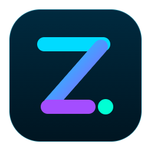
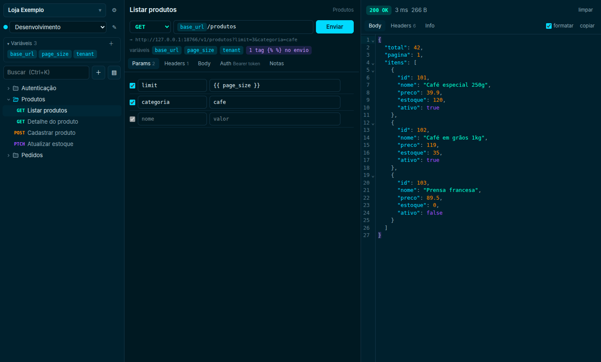
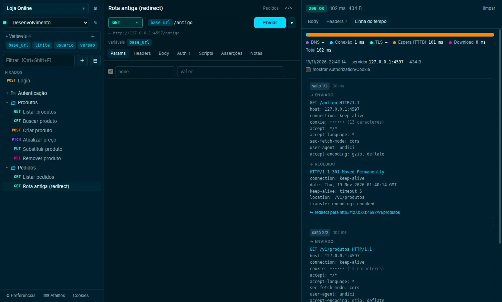
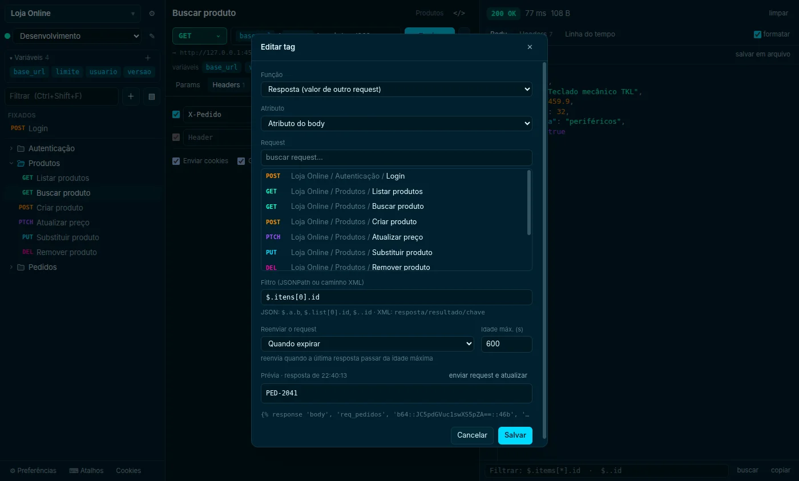
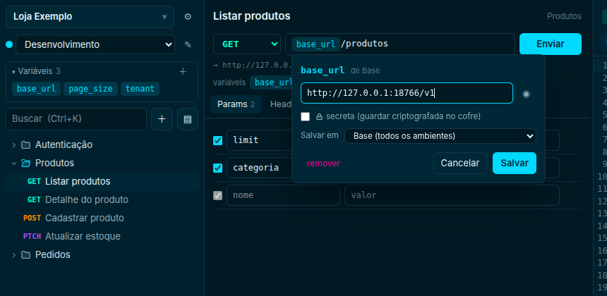

<div align="center">



# Zeno

**Cliente de API desktop focado: uma tela, sem abas, coleções em YAML e segredos criptografados.**

[](https://github.com/chmenegatti/zeno/releases/latest)
[](https://github.com/chmenegatti/zeno/actions/workflows/ci.yml)
[](LICENSE)

[](CONTRIBUTING.md)
[](https://www.cesarmenegatti.com/zeno/)

**[Site](https://www.cesarmenegatti.com/zeno/)** · [Instalação](#instalação) · [Recursos](#recursos) · [Primeiros passos](#primeiros-passos) · [Cofre de segredos](#cofre-de-segredos) · [Scripts](#scripts-e-testes) · [Git](#git-e-trabalho-em-equipe) · [Roadmap](#roadmap) · [Contribuir](CONTRIBUTING.md)



</div>

## Por que o Zeno?

Clientes de API populares foram ganhando abas, contas na nuvem e telas cada vez mais cheias. O Zeno vai no sentido oposto:

- **Uma tela só.** Lateral com as coleções, request no meio, resposta à direita. Clicar num request troca o conteúdo; nada se empilha.
- **Seus dados são arquivos.** Cada request é um arquivo YAML legível, numa pasta sua. Dá pra versionar no git, revisar em PR e editar no seu editor favorito.
- **Segredos não vazam.** Senhas e tokens ficam criptografados no próprio YAML, com a chave guardada no chaveiro do sistema.
- **Migração sem dor.** Importa as coleções do Insomnia direto da pasta dele, incluindo ambientes e encadeamento de tokens.
- **Local primeiro.** Sem conta, sem telemetria, sem sincronização obrigatória.
- **Leve.** Feito em Go, com a janela no navegador do próprio sistema: pacote de 6 a 17 MB e cerca de 220 MB de memória com o app parado.
- **Do seu jeito.** 20 temas, atalhos iguais aos do Insomnia (e editáveis), paleta de comandos e plugins no formato do Insomnia.

<table>
  <tr>
    <td width="50%"><br /><sub><b>Linha do tempo</b>: o request como saiu, redirects, tempos e TLS</sub></td>
    <td width="50%"><br /><sub><b>Gerar código</b> em 20 linguagens, colorido e com tags resolvidas</sub></td>
  </tr>
  <tr>
    <td width="50%"><br /><sub><b>Encadeamento</b> com <code></code> e prévia do valor</sub></td>
    <td width="50%"><br /><sub><b>20 temas</b>, escuros e claros</sub></td>
  </tr>
</table>

## Recursos

| | |
|---|---|
| **HTTP completo** | Todos os métodos, params, headers, body JSON/XML/texto/form/multipart com arquivo, redirects, timeout e cancelamento |
| **GraphQL** | Editor de consulta com autocomplete e validação pelo schema (introspecção na URL do request, com headers e auth), variáveis em JSON com `{{ }}`, escolha da operação e formatação; importa o GraphQL do Insomnia e do Postman |
| **Autenticação** | Basic, Bearer, API key (header ou query) e **OAuth 2.0** (authorization code com PKCE, client credentials, senha, device code e implicit; login no navegador do sistema, token em cache cifrado no cofre e renovado sozinho), com herança da pasta |
| **Ambientes e variáveis** | `{{ var }}` e `{{ _.var }}` com herança Base → sub-ambiente → pasta; editor com `Ctrl+E`, troca com `Ctrl+Shift+E` |
| **Badges de variáveis** | Variáveis aparecem como badges em todos os campos e editores, com autocomplete ao digitar `{{`; clique pra ver, editar, criar ou mover |
| **Scripts e testes** | JavaScript antes do envio e depois da resposta (por request ou pasta), com `zeno.test`/`zeno.expect`; scripts do Insomnia e do Postman rodam sem mudança |
| **Asserções e executor** | Checagens de status, header, JSONPath, body e tempo sem programar; rode uma pasta inteira com iterações, dados CSV/JSON e relatório JUnit, no app ou com `zeno run` no CI |
| **Encadeamento e funções** | `` usa o body, header ou URL de outro request, reenviando só quando o valor expira; `uuid`, `timestamp`, `faker`, `hash`, `base64`, `file`, `prompt` e `jsonpath` |
| **Cofre de segredos** | AES-256-GCM com a chave protegida pelo chaveiro do sistema (gnome-keyring/KWallet no Linux, DPAPI no Windows, Keychain no macOS) |
| **cURL e código** | Cole um `curl` na URL e o request é montado; copie como cURL ou gere código em 20 linguagens e 37 bibliotecas (Shell, JavaScript, Node, Python, Go, Java, C#, PHP, Ruby, Kotlin, Swift, Rust, PowerShell…), com realce de sintaxe, indentação de 2 espaços e variáveis e tags já resolvidas (`Ctrl+Shift+G`) |
| **Importação** | Insomnia (pasta, export v4 e v5), OpenAPI 3 e Swagger 2 (arquivo ou URL) e Postman v2.1 com ambientes, com prévia e lista do que não foi convertido |
| **Organização** | Pastas aninhadas, arrastar pra mover/reordenar, duplicar, renomear, fixar; paleta de comandos com `Ctrl+P`; tela de workspaces (`Ctrl+Shift+O`) com busca em todos os requests, grupos, cores, favoritos, arquivar, git e cofre de cada um |
| **Resposta** | JSON formatado com destaque de sintaxe, filtro JSONPath/XPath salvo por request, busca (`Ctrl+F`), clique na chave pra copiar o caminho ou a tag ``, headers, tempos e histórico das últimas 20 respostas |
| **Rede** | Proxy por workspace (do sistema ou personalizado, HTTP/HTTPS/SOCKS5, com exceções), CA própria somada às do sistema e certificado de cliente (mTLS) por host, em PEM ou PFX com a senha no cofre |
| **Cookies** | Jar por workspace, inclusive em redirects, com tela pra ver e editar (`Ctrl+K`) |
| **Plugins** | Formato do Insomnia (`templateTags`, hooks, ações) e importadores, isolados e com liga/desliga |
| **Salvar no GitHub** | Entre com o GitHub CLI ou um token e envie os workspaces pra um repositório privado (um commit por envio); baixe em outra máquina |
| **Git integrado** | Workspace dentro do repo do projeto, com status, diff por request, commit, pull, push e branches |
| **Temas** | 20 temas embutidos: TOTVS (padrão), Aura Dark, Monokai, Synthwave '84, Dracula, One Dark, Nord, Tokyo Night, Catppuccin, Gruvbox, Solarized, Night Owl, GitHub, Rosé Pine e Palenight, com 5 claros. Em Preferências ou `Ctrl+P` › *Tema* |
| **Arquivos vivos** | Editou o YAML por fora ou deu `pull`? O app recarrega na hora |

## Instalação

Baixe o pacote na [página de releases](https://github.com/chmenegatti/zeno/releases/latest).

**Debian/Ubuntu (.deb)**

```bash
sudo apt install ./zeno_*_amd64.deb
```

**Fedora (.rpm)**

```bash
sudo dnf install ./zeno-*.x86_64.rpm
```

**Qualquer distribuição (AppImage)**

```bash
chmod +x Zeno-*.AppImage
./Zeno-*.AppImage
```

O AppImage usa o WebKitGTK do sistema; se faltar, ele mostra como instalar (`libwebkit2gtk-4.1-0` no Debian/Ubuntu, `webkit2gtk4.1` no Fedora).

**Windows 10 e 11**

Rode o `Zeno-*-windows-setup.exe` (ou use a versão portátil `Zeno-*-windows-portable.zip`). O app ainda não é assinado: se o SmartScreen avisar *O Windows protegeu o computador*, clique em **Mais informações** e depois em **Executar assim mesmo**.

**macOS (Intel e Apple Silicon)**

Abra o `Zeno-*-macos-universal.dmg` e arraste o Zeno para **Aplicativos**. O app ainda não tem notarização da Apple: na primeira abertura o macOS bloqueia; vá em **Ajustes do Sistema › Privacidade e Segurança** e clique em **Abrir mesmo assim**.

### A partir do código

Requer Go 1.26+, Node.js 22+ e, no Linux, `libgtk-3-dev` e `libwebkit2gtk-4.1-dev`.

```bash
git clone https://github.com/chmenegatti/zeno.git
cd zeno
npm install
npm run dev        # compila a interface e o app e abre
```

## Primeiros passos

1. **Importe** (opcional): menu do workspace → *Importar…*. Lê o Insomnia instalado, arquivos (export do Insomnia, OpenAPI/Swagger, coleção e ambientes do Postman) ou a URL de um spec. Escolha os workspaces na prévia e deixe marcada a opção de criptografar senhas e tokens.

   Do OpenAPI sai uma pasta por tag, um request por operação, `{{ base_url }}` com o primeiro servidor, parâmetros de path como `{{ id }}` e body de exemplo montado do schema.
2. **Ou crie do zero**: *Novo workspace*, depois `Ctrl+N` para um request.
3. **Defina variáveis**: clique no ✎ ao lado do ambiente ou em ＋ na seção *Variáveis*. Use `{{ base_url }}/recurso` na URL.
4. **Envie** com `Ctrl+Enter`.

> Quer só experimentar? Importe [`examples/insomnia/github-api.insomnia.json`](examples/insomnia/github-api.insomnia.json) (*Importar… › Arquivo*, ou pela URL do arquivo *raw* no GitHub): requests pra API pública do GitHub com variáveis, dois ambientes, encadeamento com ``, scripts com testes, resposta em HTML e imagem. A pasta *Autenticado* usa `github_token`: ponha um token no ambiente Base e marque como segredo pra ele ir pro cofre.

> Tem um `curl` pronto (da documentação ou do *Copy as cURL* do navegador)? Cole no campo de URL: método, headers, body, query, `-u` e Bearer viram campos do request.

### Atalhos

Mesmo padrão do Insomnia. Todos podem ser trocados em **⌨ Atalhos** (`Ctrl+Shift+/`): *trocar*, *+* (outra combinação) ou *padrão*. **Importar do Insomnia** traz os atalhos que você personalizou lá.

| Atalho | Ação |
|---|---|
| `Ctrl+=` / `Ctrl+-` / `Ctrl+0` | Zoom da janela (fica salvo) |
| `Ctrl+Shift+=` / `Ctrl+Shift+-` | Fonte dos editores |
| `Ctrl+\` | Mostrar/esconder a lateral |
| `Ctrl+P` | Paleta de comandos: busca difusa em requests de todos os workspaces e ações (trocar ambiente/workspace, importar, preferências…). `>` no começo = só comandos |
| `Ctrl+Shift+F` | Filtrar a lateral; com o foco num editor, formata o JSON (mantém `{{ }}` e ``) |
| `Ctrl+L` / `Ctrl+'` | Focar a URL / a resposta |
| `Ctrl+,` / `Ctrl+Shift+,` | Preferências (zoom, fontes) / configurações do workspace |
| `Ctrl+Shift+/` | Lista de atalhos |
| `Ctrl+Enter`, `Ctrl+R`, `F5` | Enviar request |
| `Ctrl+Shift+Enter` | Opções de envio: enviar depois de N segundos ou repetir a cada N segundos (também no ▾ ao lado do Enviar) |
| `Ctrl+K` | Cookies do workspace |
| `Ctrl+Shift+P` | Fixar/desafixar o request no topo da lateral |
| `Ctrl+N` / `Ctrl+Shift+N` | Novo request / nova pasta (na pasta atual) |
| `Ctrl+D` / `Ctrl+Shift+Backspace` | Duplicar / excluir o request |
| `Ctrl+Shift+L` / `Ctrl+Shift+H` / `Ctrl+Shift+G` | Método HTTP / histórico de respostas / gerar código |
| `Ctrl+E` / `Ctrl+Shift+E` | Editar ambientes / trocar ambiente |
| `Alt+Shift+U` | Badges de variável mostram o valor em vez do nome (secretos continuam mascarados) |
| `Ctrl+S` | Salvar agora (o salvamento já é automático) |
| `F11`, `Ctrl+Alt+I`, `Ctrl+Q` | Tela cheia, DevTools, sair |
| Duplo clique | Renomear item na lateral |
| Botão direito | Menu de contexto (novo, duplicar, copiar como cURL, gerar código, excluir) |

## Variáveis e ambientes

Cada workspace tem um ambiente **Base** e quantos sub-ambientes quiser (Desenvolvimento, Produção…). Pastas também podem ter variáveis. Na hora de enviar, vale a definição mais específica: **pasta > sub-ambiente ativo > Base**.



Clique em qualquer badge para ver de onde vem o valor, mudar, mover para outro nível ou marcar como secreto. Badge laranja indica variável que não existe no ambiente ativo; clicar nela já cria.

As variáveis viram badge em todo lugar: URL, params, headers, auth, campos de formulário e também nos editores de body e de ambientes. Digitar `{{` abre a lista de variáveis do ambiente ativo, com valor (secretos mascarados) e origem; `Ctrl+Espaço` mostra variáveis e tags. `Alt+Shift+U` troca o nome pelo valor nos badges.

### Tags de template

| Tag | O que faz |
|---|---|
| `` | Valor da resposta de outro request (JSONPath ou caminho XML). Gatilhos: `never`, `no-history`, `when-expired`, `always` |
| `` | Header da resposta de outro request |
| `` | O request também pode ser indicado pelo nome ou pelo caminho `Pasta / Nome` |
| `` | UUID aleatório |
| `` | Data e hora atual (ISO 8601) |
| `` | Timestamp em milissegundos, segundos ou ISO |
| `` | Dado falso com os nomes do Insomnia/Postman: `randomFullName`, `randomEmail`, `randomPhoneNumber`, `randomCPF`, `randomUUID`, `randomInt`, `randomCity`… |
| `` | Hash md5/sha1/sha256/sha512 em hex ou base64 |
| `` | Codifica/decodifica base64 (normal ou URL-safe) |
| `` | Conteúdo de um arquivo |
| `` | Pergunta na hora de enviar (uma vez por envio; pode lembrar até fechar o app). Cancelar não envia |
| `` | JSONPath sobre um texto JSON (ex.: variável) |

Os argumentos aceitam `{{ variáveis }}`. Clicar no badge abre um formulário próprio de cada função, com prévia do valor.

A sintaxe é a mesma do Insomnia, então coleções importadas funcionam sem ajuste. Nos campos (URL, params, headers, auth, body) e no JSON dos ambientes e das variáveis da pasta, a tag aparece como badge, por exemplo `ƒ Resposta ⇒ Login · $.access_token`; clique nele pra editar request, atributo, filtro e gatilho, com prévia do valor. `Ctrl+Espaço` lista variáveis e tags (escolha *Outra tag…* pra abrir o editor); nos editores (body, ambientes) também dá pra digitar `respon…`, `uuid` ou `now` e escolher a sugestão. Badge vermelho = request referenciado não existe.

## Resposta

- **Filtro**: abaixo do body, `$.items[*].id`, `$..id` ou `$.data['nome completo']` para JSON; XPath (`//item/id`, `count(//item)`) para XML e HTML. O resultado aparece na hora, um filtro inválido mostra o erro sem esconder o body, e o filtro fica salvo por request.
- **Busca**: `Ctrl+F` com o foco na resposta (ou **buscar**), com regex, maiúsculas/minúsculas e palavra inteira.
- **Visualizadores**: imagem, PDF (com o visualizador do Chromium), HTML renderizado num iframe isolado (sem scripts), áudio e vídeo; **Visual / Texto** alterna pro texto puro. **Salvar em arquivo** grava qualquer resposta (nome sugerido pelo `Content-Disposition`, URL ou tipo).
- **Respostas grandes**: acima de 5 MB, o body vai pra um arquivo próprio em `.responses/bodies/` e a tela mostra os primeiros 256 KB; **carregar tudo** traz o resto quando você quiser. Scripts e `` sempre usam o body completo.
- **Linha do tempo**: o request exatamente como saiu (linha, headers brutos com `Host`/`user-agent`, body), cada salto de redirect com o que voltou, tempos de DNS, conexão, TLS, espera e download, e o certificado TLS (emissor, validade, SHA-256). `Authorization` e `Cookie` ficam escondidos até marcar *mostrar*.
- **Comparar**: diff de body ou de status/headers entre a resposta atual e outra do histórico.
- **Caminho do JSON**: clique no nome de uma chave para copiar o caminho (`$.data.users[0].id`), copiar uma tag `` pronta ou filtrar por ele.

## Plugins

Plugins no formato do Insomnia (`templateTags`, `requestHooks`, `responseHooks`, `requestActions`) e importadores ficam em `plugins/` na pasta de dados. Em **Preferências › Plugins…** dá pra ligar, desligar e recarregar. Plugin com erro aparece desativado, com o motivo, sem derrubar o app. Veja [docs/plugins.md](docs/plugins.md) e o [plugin de exemplo](examples/plugins/zeno-plugin-exemplo).

## Salvar no GitHub

Menu do workspace › **Salvar no GitHub…** (ou `Ctrl+P` › *GitHub*):

1. **Entre**: **Entrar com GitHub** abre o navegador, você digita o código mostrado e autoriza o app *zeno*. Também dá pra usar a sessão do GitHub CLI (`gh auth login` feito antes) ou colar um token com acesso a repositórios. O token fica cifrado no cofre, com a chave no chaveiro do sistema.
2. **Envie**: escolha os workspaces. Eles vão pra um repositório **privado** (`zeno-collections`, criado na primeira vez; dá pra trocar o nome), cada um numa pasta, num commit só. Arquivos apagados no app saem do repositório, e envio sem mudança não cria commit.
3. **Baixe em outra máquina**: a lista mostra o que está no repositório; *baixar* cria o workspace, *atualizar daqui* troca a versão local.

Segredos do cofre vão cifrados. Em outra máquina, use o mesmo chaveiro ou informe os valores de novo. Não precisa ter `git` instalado: tudo passa pela API do GitHub.

## Cookies

Cada workspace tem um jar de cookies, como no Insomnia: o `Set-Cookie` das respostas (inclusive nos redirects, como no login que devolve 302) fica guardado e vai automaticamente nos requests seguintes, respeitando domínio, caminho, `Secure` e expiração. Cookies expirados são descartados. `Ctrl+K` (ou **Cookies** no rodapé da lateral) abre a tela para ver, editar, apagar e limpar. Na aba **Headers** de cada request dá para desligar *Enviar cookies* ou *Guardar cookies da resposta*. O jar fica em `<pasta de dados>/.cookies/`, fora dos YAML e do git.

## Scripts e testes

Cada request (e cada pasta) tem uma aba *Scripts* com dois editores: **antes do envio** e **depois da resposta**. Os da pasta rodam antes dos do request.

```js
// depois do login: guarda o token pro próximo request usar em {{ token }}
const body = zeno.response.json()
zeno.environment.set('token', body.access_token)

zeno.test('login ok', () => {
  zeno.expect(zeno.response.code).to.equal(200)
  zeno.expect(body).to.have.property('access_token').that.is.a('string')
})
```

| API | O que faz |
|---|---|
| `zeno.environment` / `zeno.baseEnvironment` | `get`, `set`, `unset`, `has`, `toObject` no ambiente ativo / Base. O que muda é salvo no YAML; nomes como `token` e `senha` vão cifrados pro cofre |
| `zeno.variables` | Variáveis só deste envio (`{{ nome }}` no request) |
| `zeno.request` | `method`, `url`, `headers.add/upsert/remove`, `url.addQueryParams`, `body.raw` (antes do envio) |
| `zeno.response` | `code`, `status`, `headers.get`, `json()`, `text()`, `responseTime` (depois da resposta) |
| `zeno.test(nome, fn)` / `zeno.expect` | Testes com asserções no estilo chai; o resultado aparece na aba *Testes* da resposta |

`insomnia.*` e `pm.*` são apelidos de `zeno.*`, então scripts importados do Insomnia e do Postman funcionam nos casos comuns. Os scripts rodam isolados: sem rede, arquivos, `require` ou timers, com limite de 5 s. Erro no script aparece no painel; se for no pré-request, o envio não acontece.

### Asserções

Na aba *Asserções* do request dá pra checar a resposta sem escrever código: status, header, campo por JSONPath (`$.user.id`, `$.items[*].id`, `$..id`), body e tempo, com `=`, `≠`, `contém`, `<`, `>`, `existe` e regex. O valor esperado aceita `{{ variáveis }}`. O resultado aparece junto dos testes dos scripts.

### Rodar uma pasta (executor de coleção)

Clique com o botão direito numa pasta e escolha **Rodar pasta…** (ou, no espaço vazio da lateral, **Rodar workspace…**). Os requests rodam na ordem da lateral e o que um script grava (um token, por exemplo) vale para os seguintes. Dá pra escolher o ambiente, repetir em várias iterações, esperar entre requests, parar na primeira falha e usar um CSV (com cabeçalho) ou JSON (lista de objetos) em que cada linha vira variáveis de uma iteração. O relatório mostra cada request e cada asserção, e pode ser exportado como JUnit XML.

### Linha de comando (CI)

```sh
zeno run "Minha API" Usuários --env Homolog --junit relatorio.xml
zeno run ./api-workspace --data usuarios.csv --var token=$API_TOKEN   # pasta com workspace.yaml, ex.: no repositório
```

| Opção | |
|---|---|
| `-e, --env <nome>` | sub-ambiente |
| `-n, --iterations <n>` / `-d, --delay <ms>` | repetições e atraso entre requests |
| `--data <arquivo>` | CSV ou JSON; uma iteração por linha |
| `--var nome=valor` | variável extra (vale sobre ambiente e dados); repita quantas vezes quiser |
| `--junit <arquivo>` | relatório JUnit XML |
| `--bail` | para no primeiro request que falhar |
| `--data-dir <dir>` | pasta de dados do Zeno |

Sai com `0` se tudo passou, `1` se algum request ou teste falhou e `2` em erro de uso. Na CLI, o que os scripts gravam nos ambientes vale só durante a execução: os YAML não mudam. `zeno run` usa o chaveiro pra abrir os segredos cifrados; sem chaveiro (ex.: no CI), passe-os com `--var`.

No CI, use o **`zeno-cli`**: binário só da linha de comando, sem interface, em cada release (`Zeno-*-linux-cli.tar.gz`, `Zeno-*-macos-cli.zip`; no Windows vem no `.zip` portátil) ou com `go install github.com/chmenegatti/zeno/wails/cmd/zeno-cli@latest`.

Exemplo de workflow do GitHub Actions em [docs/github-actions.md](docs/github-actions.md).

## Cofre de segredos

- Valores marcados como secretos ficam no YAML como `$zeno$v1$…` (AES-256-GCM). **Esses arquivos podem ir para o git.**
- A chave mestra (256 bits, aleatória) fica em `.vault/key`, cifrada pelo chaveiro do sistema: Secret Service (gnome-keyring, KWallet) no Linux, DPAPI no Windows e Keychain no macOS. No Linux o formato é o mesmo do `safeStorage` das versões em Electron: a chave criada antes da 1.0 continua abrindo. Sem um chaveiro de verdade, o Zeno se recusa a criar o cofre.
- Só o processo do app (em Go) decifra, e só na hora de enviar ou quando você clica em *mostrar*. A interface exibe `••••••`.
- Em *Configurações do workspace → Cofre de segredos*, o Zeno encontra e cifra de uma vez senhas, tokens, headers `Authorization` e valores repetidos de segredos.
- Em outro computador, sem a chave, o Zeno avisa e pede para redefinir o valor.

Detalhes e limitações em [SECURITY.md](SECURITY.md).

## Git e trabalho em equipe

Um workspace pode morar dentro do repositório do seu projeto, junto do código:

1. *Configurações do workspace → Local e git → Mover para pasta…* e escolha uma pasta do repo (ex.: `meu-projeto/api/`). Se a pasta já tiver outros arquivos, o Zeno cria uma subpasta com o nome do workspace.
2. O botão de branch ao lado do nome do workspace abre o painel Git: arquivos alterados com o nome do request, diff, commit, pull, push e troca ou criação de branch.
3. Quem clona o repo usa *Abrir workspace de uma pasta…* no menu de workspaces.

Detalhes:

- Cada request é um arquivo, então duas pessoas editando requests diferentes fazem merge sem conflito. O pull usa `--rebase --autostash`; se mesmo assim houver conflito, o painel avisa e oferece desfazer.
- O commit leva só a pasta do workspace, nunca o resto do repositório.
- Respostas, estado da tela e a chave do cofre ficam na pasta de dados, fora do repo. Se houver segredo em texto puro, o painel bloqueia o commit e oferece criptografar antes.
- Quem não tem a chave do cofre vê os segredos como indisponíveis e define o próprio valor.
- Usa o `git` instalado, com a sua configuração, chaves SSH e credential helpers.
- Remover um workspace vinculado só o tira do Zeno; os arquivos continuam no repo.

## Onde ficam os dados

Por padrão em `~/.local/share/zeno/`, dentro da pasta do usuário também no Windows e no macOS (ou na pasta indicada por `ZENO_DATA_DIR`). É a mesma pasta e o mesmo formato das versões em Electron: atualizar não muda nada nos seus dados.

```text
<workspace>/workspace.yaml
<workspace>/_env/<ambiente>.yaml        # Base (parentId: null) e sub-ambientes
<workspace>/<pasta>/folder.yaml         # headers, auth e variáveis herdadas
<workspace>/<pasta>/<request>.yaml
.vault/key                              # chave do cofre, protegida pelo chaveiro
.responses/<requestId>.json             # últimas 20 respostas (não versionar)
state.json                              # workspace, request e ambiente ativos
links.json                              # workspaces que moram em outras pastas (ex.: num repo)
```

Exemplo de request:

```yaml
id: req_produtos
name: Listar produtos
method: GET
url: "{{ base_url }}/produtos"
params:
  - { name: limit, value: "{{ page_size }}", enabled: true }
headers:
  - { name: X-Tenant, value: "{{ tenant }}", enabled: true }
auth:
  type: bearer
  token: ""
sortKey: 1
```

## Roadmap

Os próximos passos estão nas [issues abertas](https://github.com/chmenegatti/zeno/issues), entre eles:

- gRPC, WebSocket e SSE
- mock server
- assinatura dos pacotes de Windows e macOS

Quer ajudar em algum? Comente na issue antes de começar.

## Desenvolvimento

Precisa de **Go** (1.26+), **Node.js** 22+ e, no Linux, `libgtk-3-dev` e `libwebkit2gtk-4.1-dev`.

| Comando | O que faz |
|---|---|
| `npm run dev` | Compila a interface e abre o app (`make run` em `wails/`) |
| `npm test` / `npm run typecheck` | Testes da interface (Vitest) e checagem de tipos |
| `cd wails && make test` | Testes do Go (sem interface) |
| `cd wails && make e2e` | Ponta a ponta no app de verdade (precisa de tela; no CI com `xvfb-run`) |
| `cd wails && make build` | Binário do app em `wails/build/zeno` |
| `cd wails && make cli` | `zeno-cli` estático, sem interface |
| `cd wails && make deb rpm appimage` | Pacotes Linux |
| `npm run release` | Nova versão: changelog, tag e commit de release (os pacotes dos três sistemas saem pelo workflow *Release*) |

Stack: **Go + [Wails](https://wails.io)** (janela no WebKitGTK, WebView2 ou WKWebView), React, TypeScript, Vite, Tailwind CSS, CodeMirror 6, Zustand e [goja](https://github.com/dop251/goja) para scripts e plugins.

```text
wails/            app em Go: main.go, canais da interface (handlers.go) e wails/internal/*
  internal/store    YAML dos workspaces, histórico, estado
  internal/httpc    envio HTTP (redirects, TLS, timeline)
  internal/engine   envio completo: variáveis, tags, scripts, plugins, asserções
  internal/vault    cofre (keyring: Secret Service, DPAPI, Keychain)
  internal/…        importers, gitws, github, runner, cli, plugins, scripts, cookies…
  e2e/              teste ponta a ponta no app
src/renderer/     interface React (compilada com o Vite e embutida no binário)
src/shared/       tipos e lógica pura da interface (variáveis, tags, cURL, temas)
test/             testes Vitest
```

Para verificar a interface sem mexer na janela:

```bash
ZENO_DATA_DIR=/tmp/zeno-teste ZENO_SCRIPT='console.log(document.title)' ./wails/build/zeno
```

`ZENO_SCRIPT` roda JavaScript na página (o `console.log` sai no terminal) e o app fecha no fim; `ZENO_TRACE=1` mostra o tempo de cada canal. Mais detalhes em [CONTRIBUTING.md](CONTRIBUTING.md).

## Contribuindo

Contribuições são muito bem-vindas: correções, recursos, documentação e traduções. Leia o [guia de contribuição](CONTRIBUTING.md) e o [código de conduta](CODE_OF_CONDUCT.md).

## Licença

[MIT](LICENSE) © Cesar Menegatti

O Zeno é um projeto independente, inspirado no fluxo de trabalho do [Insomnia](https://insomnia.rest) e do [Yaak](https://yaak.app), sem afiliação com eles. A paleta de cores segue a identidade visual da [TOTVS](https://marca.totvs.com).
