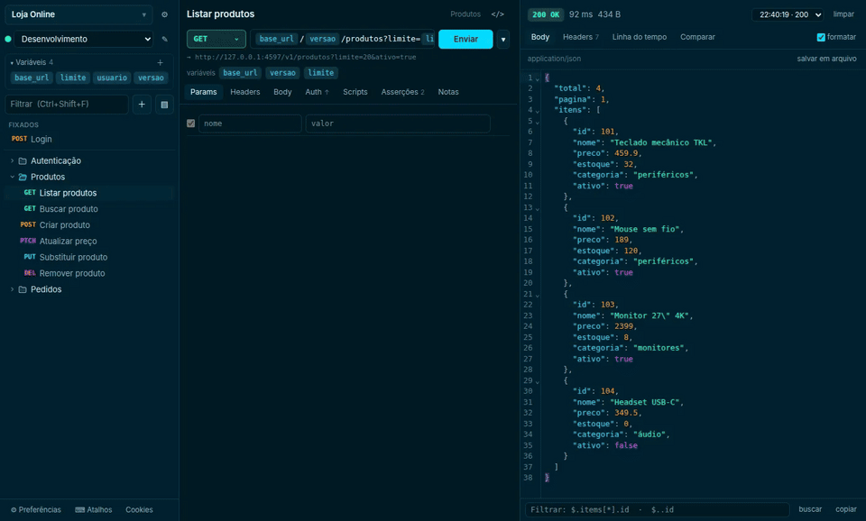
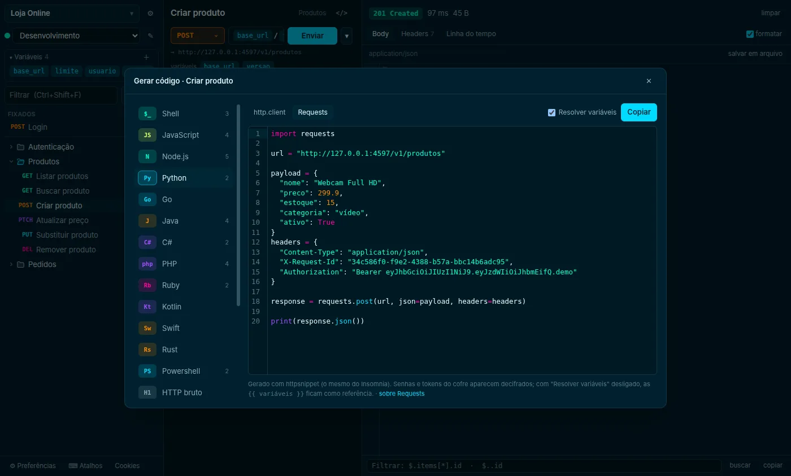
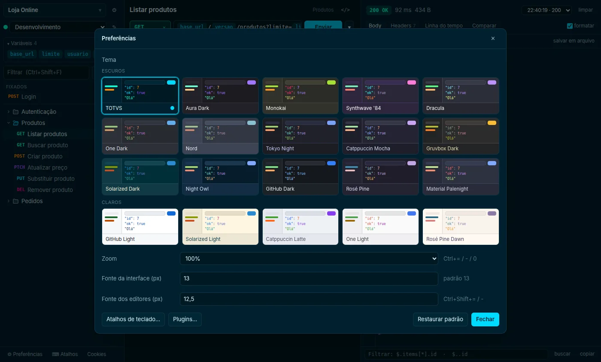

<div align="center">

**English** · [Português](README.pt-BR.md)


# Zeno

**A focused desktop API client for REST, GraphQL, gRPC and WebSocket: one screen, no tabs, YAML collections and encrypted secrets.**

[](https://github.com/chmenegatti/zeno/releases/latest)
[](https://github.com/chmenegatti/zeno/actions/workflows/ci.yml)
[](LICENSE)

[](CONTRIBUTING.md)
[](https://www.cesarmenegatti.com/zeno/)

A local-first, tab-less alternative to Insomnia and Postman: no account, no cloud, and your collections are plain YAML files you can keep in your git repo.

**[Website](https://www.cesarmenegatti.com/zeno/)** · [Installation](#installation) · [Features](#features) · [Getting started](#getting-started) · [Secrets vault](#secrets-vault) · [Scripts](#scripts-and-tests) · [Git](#git-and-teamwork) · [Roadmap](#roadmap) · [Contributing](CONTRIBUTING.md)



</div>

## Why Zeno?

Popular API clients keep piling on tabs, cloud accounts and ever more crowded screens. Zeno goes the other way:

- **One screen.** Collections in the sidebar, request in the middle, response on the right. Clicking a request swaps the content; nothing piles up.
- **Your data is files.** Every request is a readable YAML file in a folder you own. Version it in git, review it in PRs and edit it in your favorite editor.
- **Secrets don't leak.** Passwords and tokens are encrypted inside the YAML itself, with the key stored in the OS keychain.
- **Painless migration.** Imports Insomnia collections straight from its data folder, including environments and token chaining.
- **Local-first.** No account, no telemetry, no mandatory sync.
- **Lightweight.** Built in Go, rendering in the OS's own web view: an 8–24 MB package and about 220 MB of memory when idle.
- **Your way.** English or Portuguese interface, 20 themes, Insomnia-compatible (and remappable) shortcuts, a command palette and Insomnia-format plugins.

<table>
  <tr>
    <td width="50%"><br /><sub><b>Timeline</b>: the request as it went out, redirects, timings and TLS</sub></td>
    <td width="50%"><br /><sub><b>Code generation</b> in 20 languages, highlighted and with tags resolved</sub></td>
  </tr>
  <tr>
    <td width="50%"><br /><sub><b>Chaining</b> with <code></code> and a value preview</sub></td>
    <td width="50%"><br /><sub><b>20 themes</b>, dark and light</sub></td>
  </tr>
</table>

## Features

| | |
|---|---|
| **Full HTTP** | All methods, params, headers, JSON/XML/text/form/multipart bodies with file upload, redirects, timeout and cancellation |
| **GraphQL** | Query editor with schema-based autocomplete and validation (introspection against the request URL, with headers and auth), JSON variables with `{{ }}`, operation picker and formatting; imports GraphQL requests from Insomnia and Postman |
| **WebSocket and SSE** | A `ws://`/`wss://` URL becomes a WebSocket connection: connect, send the body as a message (with variables and tags), timestamped log of sent/received messages, filter and pretty-printed JSON; `text/event-stream` responses show each event as it arrives, with a stop button and an *Events* tab in the history. Auth, cookies, proxy and mTLS work just like HTTP |
| **gRPC** | A `grpc://host:port` URL (or `grpcs://` for TLS) becomes a gRPC call: services and methods via server reflection or a `.proto` file, JSON message with a sample generated from the schema, unary, server, client and bidi streaming with a timestamped log of each message, status and trailers; headers become metadata, auth and variables work like HTTP; imports gRPC requests from Insomnia |
| **Mock server** | ★ *example* saves a response from the history into the request (*Examples* tab: editable status, headers, body and delay, one default). *Start mock* runs a local server per workspace (`127.0.0.1:4010` or a port of your choice) that answers each route, `GET {{ base_url }}/users/{{ id }}` → `GET /users/1`, with its example; CORS enabled, 404 lists the routes, stops when the workspace is deleted or the app closes |
| **Authentication** | Basic, Bearer, API key (header or query) and **OAuth 2.0** (authorization code with PKCE, client credentials, password, device code and implicit; login in the system browser, token cached encrypted in the vault and refreshed automatically), inherited from the folder |
| **Environments and variables** | `{{ var }}` and `{{ _.var }}` with Base → sub-environment → folder inheritance; edit with `Ctrl+E`, switch with `Ctrl+Shift+E` |
| **Variable badges** | Variables show up as badges in every field and editor, with autocomplete as you type `{{`; click to view, edit, create or move |
| **Scripts and tests** | JavaScript before sending and after the response (per request or folder), with `zeno.test`/`zeno.expect`; Insomnia and Postman scripts run unchanged |
| **Assertions and runner** | Status, header, JSONPath, body and timing checks without code; run a whole folder with iterations, CSV/JSON data and a JUnit report, in the app or with `zeno run` in CI |
| **Chaining and functions** | `` uses the body, header or URL of another request, resending only when the value expires; `uuid`, `timestamp`, `faker`, `hash`, `base64`, `file`, `prompt` and `jsonpath` |
| **Secrets vault** | AES-256-GCM with the key protected by the OS keychain (gnome-keyring/KWallet on Linux, DPAPI on Windows, Keychain on macOS) |
| **cURL and code** | Paste a `curl` command into the URL and the request is built; copy as cURL or generate code in 20 languages and 37 libraries (Shell, JavaScript, Node, Python, Go, Java, C#, PHP, Ruby, Kotlin, Swift, Rust, PowerShell…), with syntax highlighting, 2-space indentation and variables and tags already resolved (`Ctrl+Shift+G`) |
| **Import** | Insomnia (data folder, v4 and v5 exports), OpenAPI 3 and Swagger 2 (file or URL) and Postman v2.1 with environments, with a preview and a list of anything that wasn't converted |
| **Export** | Zip with Zeno's YAML, Insomnia (JSON v4) and Postman (v2.1 collection + environments), for one or several workspaces, with a preview of what doesn't fit the target format and vault secrets left empty or in clear text (your choice) |
| **Organization** | Nested folders, drag to move/reorder, duplicate, rename, pin; command palette with `Ctrl+P`; workspaces screen (`Ctrl+Shift+O`) with search across all requests, groups, colors, favorites, archive, plus git, vault and GitHub status (last push and whether it changed since) for each one |
| **Response** | Pretty-printed JSON with syntax highlighting, JSONPath/XPath filter saved per request, search (`Ctrl+F`), click a key to copy its path or a `` tag, headers, timings and a history of the last 20 responses |
| **Network** | Per-workspace proxy (system or custom, HTTP/HTTPS/SOCKS5, with exclusions), custom CA added to the system ones and per-host client certificates (mTLS), in PEM or PFX with the passphrase in the vault |
| **Cookies** | Per-workspace jar, redirects included, with a screen to view and edit them (`Ctrl+K`) |
| **Plugins** | Insomnia format (`templateTags`, hooks, actions) and importers, sandboxed and individually toggleable |
| **Save to GitHub** | Sign in with the GitHub CLI or a token and push your workspaces to a private repository (one commit per push); pull them on another machine |
| **Built-in Git** | Workspace inside your project's repo, with status, per-request diff, commit, pull, push and branches |
| **Themes** | 20 built-in themes: TOTVS (default), Aura Dark, Monokai, Synthwave '84, Dracula, One Dark, Nord, Tokyo Night, Catppuccin, Gruvbox, Solarized, Night Owl, GitHub, Rosé Pine and Palenight, 5 of them light. In Preferences or `Ctrl+P` › *Theme* |
| **Live files** | Edited the YAML outside the app or ran `pull`? The app reloads instantly |

## Installation

Download the package from the [releases page](https://github.com/chmenegatti/zeno/releases/latest).

**Debian/Ubuntu (.deb)**

```bash
sudo apt install ./zeno_*_amd64.deb
```

**Fedora (.rpm)**

```bash
sudo dnf install ./zeno-*.x86_64.rpm
```

**Any distribution (AppImage)**

```bash
chmod +x Zeno-*.AppImage
./Zeno-*.AppImage
```

The AppImage uses the system's WebKitGTK; if it's missing, it tells you how to install it (`libwebkit2gtk-4.1-0` on Debian/Ubuntu, `webkit2gtk4.1` on Fedora).

**Windows 10 and 11**

Run `Zeno-*-windows-setup.exe` (or use the portable `Zeno-*-windows-portable.zip`). The app isn't signed yet: if SmartScreen shows *Windows protected your PC*, click **More info** and then **Run anyway**.

With [Scoop](https://scoop.sh): `scoop bucket add zeno https://github.com/chmenegatti/scoop-bucket` and `scoop install zeno` (portable build, with `zeno-cli` on the PATH).

**macOS (Intel and Apple Silicon)**

Open `Zeno-*-macos-universal.dmg` and drag Zeno to **Applications**. The app isn't notarized by Apple yet: macOS blocks it on first launch; go to **System Settings › Privacy & Security** and click **Open Anyway**.

With [Homebrew](https://brew.sh): `brew install --cask chmenegatti/tap/zeno`.

### From source

Requires Go 1.26+, Node.js 22+ and, on Linux, `libgtk-3-dev` and `libwebkit2gtk-4.1-dev`.

```bash
git clone https://github.com/chmenegatti/zeno.git
cd zeno
npm install
npm run dev        # builds the UI and the app, then opens it
```

## Getting started

1. **Import** (optional): workspace menu → *Import…*. Reads your installed Insomnia, files (Insomnia export, OpenAPI/Swagger, Postman collection and environments) or a spec URL. Pick the workspaces in the preview and keep the option to encrypt passwords and tokens checked.

   OpenAPI produces one folder per tag, one request per operation, `{{ base_url }}` set to the first server, path parameters like `{{ id }}` and a sample body built from the schema.
2. **Or start from scratch**: *New workspace*, then `Ctrl+N` for a request.
3. **Set variables**: click ✎ next to the environment or ＋ in the *Variables* section. Use `{{ base_url }}/resource` in the URL.
4. **Send** with `Ctrl+Enter`.

> Just want to try it? Import [`examples/insomnia/github-api.insomnia.json`](examples/insomnia/github-api.insomnia.json) (*Import… › File*, or via the file's *raw* URL on GitHub): requests to the public GitHub API with variables, two environments, `` chaining, scripts with tests, and HTML and image responses. The *Autenticado* folder uses `github_token`: put a token in the Base environment and mark it as secret so it goes into the vault.

> Got a ready-made `curl` command (from docs or the browser's *Copy as cURL*)? Paste it into the URL field: method, headers, body, query, `-u` and Bearer become request fields.

### Shortcuts

Same defaults as Insomnia. All of them can be remapped in **⌨ Shortcuts** (`Ctrl+Shift+/`): *change*, *+* (another combination) or *default*. **Import from Insomnia** brings over the shortcuts you customized there.

| Shortcut | Action |
|---|---|
| `Ctrl+=` / `Ctrl+-` / `Ctrl+0` | Window zoom (persisted) |
| `Ctrl+Shift+=` / `Ctrl+Shift+-` | Editor font size |
| `Ctrl+\` | Show/hide the sidebar |
| `Ctrl+P` | Command palette: fuzzy search across requests in all workspaces and actions (switch environment/workspace, import, preferences…). A leading `>` = commands only |
| `Ctrl+Shift+F` | Filter the sidebar; with focus in an editor, formats the JSON (keeps `{{ }}` and ``) |
| `Ctrl+L` / `Ctrl+'` | Focus the URL / the response |
| `Ctrl+,` / `Ctrl+Shift+,` | Preferences (zoom, fonts) / workspace settings |
| `Ctrl+Shift+/` | Shortcut list |
| `Ctrl+Enter`, `Ctrl+R`, `F5` | Send request |
| `Ctrl+Shift+Enter` | Send options: send after N seconds or repeat every N seconds (also in the ▾ next to Send) |
| `Ctrl+K` | Workspace cookies |
| `Ctrl+Shift+P` | Pin/unpin the request at the top of the sidebar |
| `Ctrl+N` / `Ctrl+Shift+N` | New request / new folder (in the current folder) |
| `Ctrl+D` / `Ctrl+Shift+Backspace` | Duplicate / delete the request |
| `Ctrl+Shift+L` / `Ctrl+Shift+H` / `Ctrl+Shift+G` | HTTP method / response history / generate code |
| `Ctrl+E` / `Ctrl+Shift+E` | Edit environments / switch environment |
| `Alt+Shift+U` | Variable badges show the value instead of the name (secrets stay masked) |
| `Ctrl+S` | Save now (saving is already automatic) |
| `F11`, `Ctrl+Alt+I`, `Ctrl+Q` | Full screen, DevTools, quit |
| Double-click | Rename an item in the sidebar |
| Right-click | Context menu (new, duplicate, copy as cURL, generate code, delete) |

## Variables and environments

Each workspace has a **Base** environment and as many sub-environments as you like (Development, Production…). Folders can have variables too. When sending, the most specific definition wins: **folder > active sub-environment > Base**.


Click any badge to see where its value comes from, change it, move it to another level or mark it as secret. An orange badge means the variable doesn't exist in the active environment; clicking it creates it.

Variables become badges everywhere: URL, params, headers, auth, form fields and also the body and environment editors. Typing `{{` opens the list of variables in the active environment, with value (secrets masked) and origin; `Ctrl+Space` shows variables and tags. `Alt+Shift+U` swaps names for values in the badges.

### Template tags

| Tag | What it does |
|---|---|
| `` | Value from another request's response (JSONPath or XML path). Triggers: `never`, `no-history`, `when-expired`, `always` |
| `` | Response header from another request |
| `` | The request can also be referenced by name or by its `Folder / Name` path |
| `` | Random UUID |
| `` | Current date and time (ISO 8601) |
| `` | Timestamp in milliseconds, seconds or ISO |
| `` | Fake data using the Insomnia/Postman names: `randomFullName`, `randomEmail`, `randomPhoneNumber`, `randomCPF`, `randomUUID`, `randomInt`, `randomCity`… |
| `` | md5/sha1/sha256/sha512 hash in hex or base64 |
| `` | Base64 encode/decode (normal or URL-safe) |
| `` | Contents of a file |
| `` | Asks at send time (once per send; can remember until the app closes). Cancel means the request isn't sent |
| `` | JSONPath over a JSON string (e.g. a variable) |

Arguments accept `{{ variables }}`. Clicking the badge opens a dedicated form for each function, with a value preview.

The syntax is the same as Insomnia's, so imported collections work as-is. In fields (URL, params, headers, auth, body) and in the JSON of environments and folder variables, a tag shows up as a badge, e.g. `ƒ Resposta ⇒ Login · $.access_token`; click it to edit the request, attribute, filter and trigger, with a value preview. `Ctrl+Space` lists variables and tags (pick *Other tag…* to open the editor); in the editors (body, environments) you can also type `respon…`, `uuid` or `now` and pick the suggestion. A red badge means the referenced request doesn't exist.

## Response

- **Filter**: below the body, `$.items[*].id`, `$..id` or `$.data['nome completo']` for JSON; XPath (`//item/id`, `count(//item)`) for XML and HTML. Results appear instantly, an invalid filter shows the error without hiding the body, and the filter is saved per request.
- **Search**: `Ctrl+F` with focus on the response (or **search**), with regex, case-sensitive and whole-word options.
- **Viewers**: image, PDF (with Chromium's viewer), HTML rendered in a sandboxed iframe (no scripts), audio and video; **Visual / Text** toggles to raw text. **Save to file** writes any response to disk (name suggested from `Content-Disposition`, the URL or the content type).
- **Large responses**: above 5 MB, the body goes to its own file in `.responses/bodies/` and the screen shows the first 256 KB; **load all** brings in the rest whenever you want. Scripts and `` always use the full body.
- **Timeline**: the request exactly as it went out (request line, raw headers with `Host`/`user-agent`, body), every redirect hop with what came back, DNS, connect, TLS, wait and download timings, and the TLS certificate (issuer, validity, SHA-256). `Authorization` and `Cookie` stay hidden until you check *show*.
- **Compare**: body or status/headers diff between the current response and another one from the history.
- **JSON path**: click a key name to copy its path (`$.data.users[0].id`), copy a ready-made `` tag or filter by it.

## Plugins

Insomnia-format plugins (`templateTags`, `requestHooks`, `responseHooks`, `requestActions`) and importers live in `plugins/` inside the data folder. In **Preferences › Plugins…** you can enable, disable and reload them. A broken plugin shows up disabled, with the reason, without crashing the app. See [docs/plugins.md](docs/plugins.md) and the [example plugin](examples/plugins/zeno-plugin-exemplo).

## Save to GitHub

Workspace menu › **Save to GitHub…** (or `Ctrl+P` › *GitHub*):

1. **Sign in**: **Sign in with GitHub** opens the browser, you enter the code shown and authorize the *zeno* app. You can also reuse your GitHub CLI session (`gh auth login` done beforehand) or paste a token with repository access. The token is stored encrypted in the vault, with the key in the OS keychain.
2. **Push**: choose the workspaces. They go to a **private** repository (`zeno-collections`, created the first time; the name can be changed), each in its own folder, in a single commit. Files deleted in the app are removed from the repository, and a push with no changes creates no commit.
3. **Pull on another machine**: the list shows what's in the repository; *download* creates the workspace, *update from here* replaces the local version.

Vault secrets are pushed encrypted. On another machine, use the same keychain or enter the values again. No need to have `git` installed: everything goes through the GitHub API.

## Cookies

Each workspace has a cookie jar, just like Insomnia: `Set-Cookie` from responses (including redirects, like a login that returns 302) is stored and sent automatically on subsequent requests, honoring domain, path, `Secure` and expiration. Expired cookies are discarded. `Ctrl+K` (or **Cookies** at the bottom of the sidebar) opens a screen to view, edit, delete and clear them. In each request's **Headers** tab you can turn off *Send cookies* or *Store response cookies*. The jar lives in `<data folder>/.cookies/`, outside the YAML and git.

## Scripts and tests

Each request (and each folder) has a *Scripts* tab with two editors: **before sending** and **after the response**. Folder scripts run before the request's.

```js
// after login: store the token for the next request to use as {{ token }}
const body = zeno.response.json()
zeno.environment.set('token', body.access_token)

zeno.test('login ok', () => {
  zeno.expect(zeno.response.code).to.equal(200)
  zeno.expect(body).to.have.property('access_token').that.is.a('string')
})
```

| API | What it does |
|---|---|
| `zeno.environment` / `zeno.baseEnvironment` | `get`, `set`, `unset`, `has`, `toObject` on the active / Base environment. Changes are saved to the YAML; names like `token` and `senha` (password) are encrypted into the vault |
| `zeno.variables` | Variables for this send only (`{{ name }}` in the request) |
| `zeno.request` | `method`, `url`, `headers.add/upsert/remove`, `url.addQueryParams`, `body.raw` (before sending) |
| `zeno.response` | `code`, `status`, `headers.get`, `json()`, `text()`, `responseTime` (after the response) |
| `zeno.test(name, fn)` / `zeno.expect` | Chai-style assertion tests; results show up in the response's *Tests* tab |

`insomnia.*` and `pm.*` are aliases for `zeno.*`, so scripts imported from Insomnia and Postman work in the common cases. Scripts run sandboxed: no network, files, `require` or timers, with a 5 s limit. Script errors show up in the panel; if it's a pre-request script, the request isn't sent.

### Assertions

The request's *Assertions* tab lets you check the response without writing code: status, header, a JSONPath field (`$.user.id`, `$.items[*].id`, `$..id`), body and timing, with `=`, `≠`, `contains`, `<`, `>`, `exists` and regex. The expected value accepts `{{ variables }}`. Results appear alongside the script tests.

### Running a folder (collection runner)

Right-click a folder and choose **Run folder…** (or, on the empty area of the sidebar, **Run workspace…**). Requests run in sidebar order, and whatever a script stores (a token, for example) is available to the following ones. You can pick the environment, repeat over several iterations, wait between requests, stop at the first failure and use a CSV (with a header row) or JSON (array of objects) where each row becomes the variables of one iteration. The report shows every request and assertion, and can be exported as JUnit XML.

### Command line (CI)

```sh
zeno run "Minha API" Usuários --env Homolog --junit relatorio.xml
zeno run ./api-workspace --data users.csv --var token=$API_TOKEN   # folder with workspace.yaml, e.g. in your repo
```

| Option | |
|---|---|
| `-e, --env <nome>` | sub-environment |
| `-n, --iterations <n>` / `-d, --delay <ms>` | iterations and delay between requests |
| `--data <arquivo>` | CSV or JSON; one iteration per row |
| `--var nome=valor` | extra variable (overrides environment and data); repeat as many times as needed |
| `--junit <arquivo>` | JUnit XML report |
| `--bail` | stop at the first failing request |
| `--data-dir <dir>` | Zeno data folder |

Exits with `0` if everything passed, `1` if any request or test failed and `2` on a usage error. In the CLI, what scripts write to environments only lasts for the run: the YAML files don't change. `zeno run` uses the keychain to decrypt secrets; without a keychain (e.g. in CI), pass them with `--var`.

In CI, use **`zeno-cli`**: a command-line-only binary with no UI, shipped with every release (`Zeno-*-linux-cli.tar.gz`, `Zeno-*-macos-cli.zip`; on Windows it's in the portable `.zip`) or via `go install github.com/chmenegatti/zeno/wails/cmd/zeno-cli@latest`.

A sample GitHub Actions workflow is in [docs/github-actions.md](docs/github-actions.md).

## Secrets vault

- Values marked as secret are stored in the YAML as `$zeno$v1$…` (AES-256-GCM). **These files are safe to commit.**
- The master key (256-bit, random) lives in `.vault/key`, encrypted by the OS keychain: Secret Service (gnome-keyring, KWallet) on Linux, DPAPI on Windows and Keychain on macOS. On Linux the format matches the `safeStorage` of the Electron versions: a key created before 1.0 still opens. Without a real keychain, Zeno refuses to create the vault.
- Only the app process (in Go) decrypts, and only at send time or when you click *show*. The UI displays `••••••`.
- In *Workspace settings → Secrets vault*, Zeno finds and encrypts passwords, tokens, `Authorization` headers and repeated secret values in one go.
- On another computer without the key, Zeno warns you and asks you to set the value again.

Details and limitations in [SECURITY.md](SECURITY.md).

## Git and teamwork

A workspace can live inside your project's repository, next to the code:

1. *Workspace settings → Location and git → Move to folder…* and pick a folder in the repo (e.g. `meu-projeto/api/`). If the folder already has other files, Zeno creates a subfolder named after the workspace.
2. The branch button next to the workspace name opens the Git panel: changed files with the request name, diff, commit, pull, push and branch switching or creation.
3. Whoever clones the repo uses *Open workspace from folder…* in the workspaces menu.

Details:

- Each request is a file, so two people editing different requests merge without conflicts. Pull uses `--rebase --autostash`; if there's still a conflict, the panel tells you and offers to undo.
- Commits only include the workspace folder, never the rest of the repository.
- Responses, UI state and the vault key stay in the data folder, outside the repo. If there's a plaintext secret, the panel blocks the commit and offers to encrypt it first.
- Anyone without the vault key sees secrets as unavailable and sets their own value.
- Uses your installed `git`, with your config, SSH keys and credential helpers.
- Removing a linked workspace only removes it from Zeno; the files stay in the repo.

## Where data lives

By default in `~/.local/share/zeno/`, under the user's home folder on Windows and macOS too (or in the folder set by `ZENO_DATA_DIR`). It's the same folder and format as the Electron versions: upgrading doesn't touch your data.

```text
<workspace>/workspace.yaml
<workspace>/_env/<environment>.yaml     # Base (parentId: null) and sub-environments
<workspace>/<folder>/folder.yaml        # inherited headers, auth and variables
<workspace>/<folder>/<request>.yaml
.vault/key                              # vault key, protected by the OS keychain
.responses/<requestId>.json             # last 20 responses (don't commit)
state.json                              # active workspace, request and environment
links.json                              # workspaces living in other folders (e.g. a repo)
```

Sample request:

```yaml
id: req_products
name: List products
method: GET
url: "{{ base_url }}/products"
params:
  - { name: limit, value: "{{ page_size }}", enabled: true }
headers:
  - { name: X-Tenant, value: "{{ tenant }}", enabled: true }
auth:
  type: bearer
  token: ""
sortKey: 1
```

## Roadmap

Next steps are tracked in the [open issues](https://github.com/chmenegatti/zeno/issues), including:

- code signing for the Windows and macOS packages

Want to help with one? Comment on the issue before you start.

## Development

Requires **Go** (1.26+), **Node.js** 22+ and, on Linux, `libgtk-3-dev` and `libwebkit2gtk-4.1-dev`.

| Command | What it does |
|---|---|
| `npm run dev` | Builds the UI and opens the app (`make run` in `wails/`) |
| `npm test` / `npm run typecheck` | UI tests (Vitest) and type checking |
| `cd wails && make test` | Go tests (no UI) |
| `cd wails && make e2e` | End-to-end tests against the real app (needs a display; in CI via `xvfb-run`) |
| `cd wails && make build` | App binary at `wails/build/zeno` |
| `cd wails && make cli` | Static `zeno-cli`, no UI |
| `cd wails && make deb rpm appimage` | Linux packages |
| `npm run release` | New version: changelog, tag and release commit (packages for all three OSes are built by the *Release* workflow) |

Stack: **Go + [Wails](https://wails.io)** (window on WebKitGTK, WebView2 or WKWebView), React, TypeScript, Vite, Tailwind CSS, CodeMirror 6, Zustand and [goja](https://github.com/dop251/goja) for scripts and plugins.

```text
wails/            app em Go: main.go, canais da interface (handlers.go) e wails/internal/*
  internal/store    YAML dos workspaces, histórico, estado
  internal/httpc    envio HTTP (redirects, TLS, timeline)
  internal/engine   envio completo: variáveis, tags, scripts, plugins, asserções
  internal/vault    cofre (keyring: Secret Service, DPAPI, Keychain)
  internal/…        importers, gitws, github, runner, cli, plugins, scripts, cookies…
  e2e/              teste ponta a ponta no app
src/renderer/     interface React (compilada com o Vite e embutida no binário)
src/shared/       tipos e lógica pura da interface (variáveis, tags, cURL, temas)
test/             testes Vitest
```

To check the UI without touching the window:

```bash
ZENO_DATA_DIR=/tmp/zeno-teste ZENO_SCRIPT='console.log(document.title)' ./wails/build/zeno
```

`ZENO_SCRIPT` runs JavaScript in the page (`console.log` goes to the terminal) and the app exits at the end; `ZENO_TRACE=1` shows the timing of each channel. More details in [CONTRIBUTING.md](CONTRIBUTING.md).

## Contributing

Contributions are very welcome: fixes, features, documentation and translations. Read the [contributing guide](CONTRIBUTING.md) and the [code of conduct](CODE_OF_CONDUCT.md).

## License

[MIT](LICENSE) © Cesar Menegatti

Zeno is an independent project, inspired by the workflow of [Insomnia](https://insomnia.rest) and [Yaak](https://yaak.app), and is not affiliated with them. The color palette follows [TOTVS](https://marca.totvs.com)'s visual identity.
